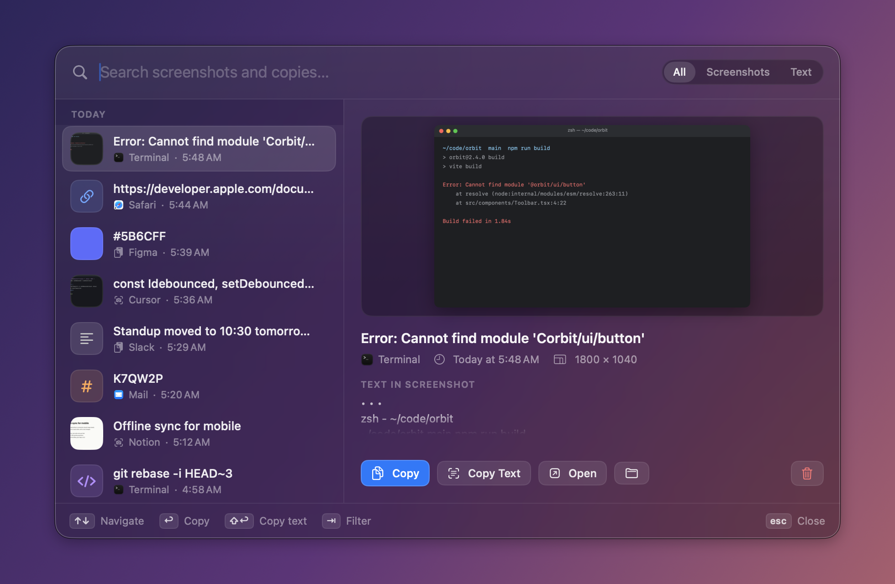
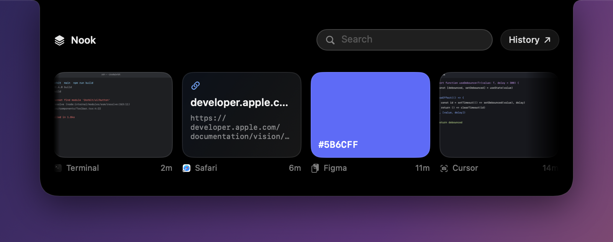

# Nook

A tiny native macOS memory for everything you copy and every screenshot you take. It lives in the notch, and nothing leaves your Mac.





## Install

1. Download **Nook.zip** from the [latest release](https://github.com/vanshtri/nook/releases/latest), unzip it, and drag **Nook.app** into **Applications**.
2. Open Nook. macOS will warn that it can't verify the developer, because the app isn't notarized yet.
   Go to **System Settings → Privacy & Security**, scroll down, and click **Open Anyway**.
   (Or in Terminal: `xattr -dr com.apple.quarantine /Applications/Nook.app`)
3. When asked, allow **Accessibility** (System Settings → Privacy & Security → Accessibility), then quit and reopen Nook.
   This is needed for the double-tap ⌘ shortcuts.

Nook has no window. Look for its icon in the menu bar, hover the top centre of the screen (or the notch), or double-tap right ⌘.
Requires macOS 13 or later.

- **Hover the notch** to open the shelf: recent screenshots and copies, with search.
- **Double-tap left ⌘** to capture an area. It's saved, OCR'd and left on the clipboard.
- Each item is labelled with the app it came from, and screenshots are titled by their largest readable text.
- **Double-tap right ⌘** to open the memory panel: a searchable list grouped by day, with a large preview of the selected item, All / Screenshots / Text filters (⇥), and ↑↓ ↩ to copy.
- **Search finds text inside screenshots** using on-device OCR (Apple Vision).
- **Copy or drag out**: ↩ or double-click copies in the panel (⇧↩ copies just the text in a screenshot), a click copies in the shelf, and anything can be dragged out as a real file or text.
- System screenshots (⌘⇧3/4/5) are picked up automatically through Spotlight.
- Secrets from password managers (concealed pasteboard types) are skipped.
- Data lives in `~/Library/Application Support/Nook` (`index.json` plus `images/`).

## Build from source

Needs only the Xcode Command Line Tools (macOS 13+).

```bash
./build.sh --install   # builds and copies Nook.app into /Applications, then launches it
```

On first launch, grant **Accessibility** (System Settings → Privacy & Security). It's needed for the double-tap ⌘ shortcuts. Relaunch Nook after granting.

No Screen Recording permission is needed. Left ⌘⌘ opens the built-in macOS screenshot tool (⌘⇧⌃4), and Nook saves the result from the clipboard.

The app is signed with a designated requirement pinned to its bundle ID, so the Accessibility grant survives rebuilds.
If it ever stops matching, remove Nook from the list with **–** and add it again.
A troubleshooting log is written to `~/Library/Application Support/Nook/debug.log`.

## Code map

| File | What it does |
|---|---|
| `Store.swift` | Item model, JSON persistence, search, OCR (Vision), thumbnails |
| `Sources.swift` | Clipboard watcher, screenshot watcher (NSMetadataQuery), region capture, double-tap ⌘ detector |
| `Windows.swift` | Notch geometry, hover zone, shelf panel, memory panel and keyboard handling |
| `Views.swift` | SwiftUI views for the shelf and the panel |
| `main.swift` | App delegate, menu bar item |

## Ideas for next steps
- Launch at login (`SMAppService.mainApp.register()`)
- Pin favourites; exclude specific apps from clipboard capture
- SQLite + FTS5 index once history gets large
- Settings window (history limit, shortcuts)

## License

[MIT](LICENSE)
